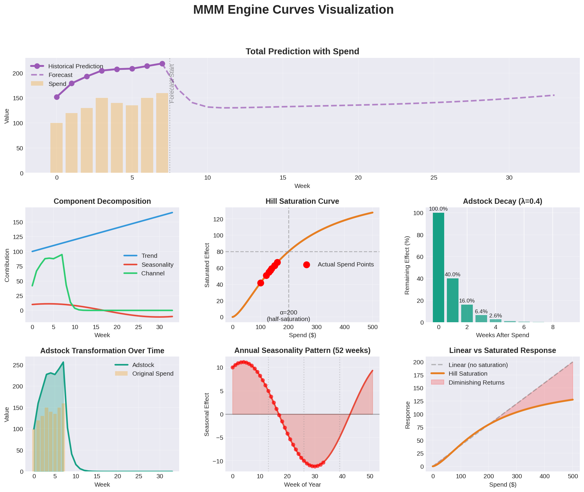

# ⚡ MMM Engine (C++23)

[](https://github.com/yablokolabs/mmm-engine/actions/workflows/ci.yml)

### **The Fastest Deterministic MMM Engine on Earth — Built with C++23**

## 🧩 Overview
**MMM Engine (C++23)** is an ultra-fast, deterministic Marketing Mix Modeling computation engine.
It performs:
- Adstock  
- Saturation  
- Trend & Seasonality  
- Channel contribution  
- Forecasting  
- Scenario simulation  
- Budget optimization  

All using **pure mathematical formulas**, with no machine learning, no Bayesian modeling, and no training loops.

It is designed to be:
- **Blazing fast** (microseconds to milliseconds)
- **Transparent & deterministic**
- **Embeddable** in enterprise systems
- **Open-source friendly**
- **Easy to integrate (JSON in → JSON out)**

This is the **fastest MMM computation engine available**, outperforming Robyn, Meridian, LightweightMMM, and all R/Python-based MMM tools.

---
## 🧮 Math Formulas

- Sample visualization of the deterministic transforms computed by the engine:



- **Geometric adstock:** $a_t = x_t + \lambda a_{t-1}$ with decay $\lambda \in [0,1)$.

- **Hill saturation:** $s_t = \frac{x_t^p}{\alpha^p + x_t^p + 10^{-9}}$ with slope $p$ and half-saturation $\alpha$.

- **Trend polynomial:** $g(t) = t_0 + t_1 t + t_2 t^2$.

- **Seasonality:** $h(t) = \sum_k a_k \cos\left(\frac{2\pi (k+1)t}{52}\right) + b_k \sin\left(\frac{2\pi (k+1)t}{52}\right)$.

- **Channel contribution:** $c_{t}^{(i)} = \beta_i \, s_{t}^{(i)}$ after adstock + saturation.

- **Prediction:** $y_t = g(t) + h(t) + \sum_i c_{t}^{(i)}$.

- **Fitting:** coordinate-descent grid search over each channel's $(\lambda, \alpha, p)$; trend, seasonality and $\beta_i \ge 0$ solved by least squares for every candidate. Deterministic: same data, same model.

- **Budget optimizer:** maximise $\sum_i \beta_i\, \text{hill}\!\left(\frac{x_i}{1-\lambda_i}\right)$ subject to $\sum_i x_i = B$ and $(1-b)\,x_i^{\text{now}} \le x_i \le (1+b)\,x_i^{\text{now}}$. Greedy marginal-return allocation, then pairwise exchange.

---
## 🚀 Key Features
- ⚡ **C++23, SIMD, mdspan, par_unseq**
- 📦 **JSON config input**
- 📤 **JSON output**
- 📈 **Deterministic forecasting**
- 🔁 **Parallel channel evaluation**
- ⏱ **Ultra-low latency (<1ms typical)**
- 🧮 **Pure mathematical MMM (no AI/ML)**
- 🧱 **Simple CLI interface**
- 📚 **Easy to extend or embed**
- 🖥️ **Cross-platform (Linux/macOS/Windows)**

---
## 🔍 What This Engine *Is*
- A **deterministic MMM simulator**
- A **formula-based forecasting engine**
- A **high-performance ROI curve executor**
- A **scenario planner**
- A **fast budgeting optimizer**
- A **transparent, predictable math engine**

## ❌ What This Engine *Is NOT*
- Not a machine learning model  
- Not Bayesian MMM (no priors, no posterior intervals)  
- Not a replacement for lift tests: MMM is correlational  

`mmm fit` estimates every parameter from your weekly history, or you can
write a config by hand and use `run` / `forecast` / `optimize` directly.

---
## 🧠 Why Deterministic MMM?
Because:
- ML MMM: minutes → hours  
- Bayesian MMM: hours → days  
- **This engine: < 1 millisecond**  

Perfect for:
- Large-scale experimentation  
- Real-time forecasting APIs  
- Embedded marketing optimization systems  
- Real world MMM at the speed of production

---
## 📦 Installation

**Prebuilt binary** (Linux x86-64 / arm64, glibc 2.38+): download from [Releases](https://github.com/yablokolabs/mmm-engine/releases).

**Docker** (any OS):
```bash
docker run --rm -v "$PWD:/work" ghcr.io/yablokolabs/mmm-engine fit --data history.csv --output model.json
```

**From source** (CMake 3.27+, GCC 13+ or Clang 17+):
```bash
git clone https://github.com/yablokolabs/mmm-engine
cd mmm-engine
./build.sh && ./build/mmm_tests
```

## 🖥️ CLI Usage

Fit a model from weekly history (CSV: `week,sales,<one spend column per channel>`):
```
./mmm fit --data history.csv --target sales --holdout 13 --output model.json
```
The last `--holdout` weeks are never used for fitting; their accuracy is reported.

Reallocate the weekly budget (default: current spend, each channel within ±50%):
```
./mmm optimize --config model.json --bound 0.5 --output plan.json
```

Forecast with a spend plan (planned spend now drives the forecast):
```
./mmm forecast --config model.json --weeks 13 --plan plan.json --output forecast.json
```

Run MMM prediction:

```
./mmm run --config model.json --output out.json
```
Forecast N future weeks:
```
./mmm forecast --config model.json --weeks 26 --output forecast.json
```

## 📄 Example JSON Config
```
{

  "trend": { "t0": 100, "t1": 2, "t2": 0 },
  "seasonality": {
    "a": [10],
    "b": [5]
  },
  "channels": [
    {
      "name": "Facebook",
      "params": { "beta": 0.8, "alpha": 200, "p": 1.5, "decay": 0.4 },
      "spend": [100,120,130,150,140,135,150,160]
    }
  ]
}
```

## ✅ Accuracy on data with known answers

`examples/synthetic` generates 3 years of weekly sales from known channel
curves, fits them, and grades the result (`examples/synthetic/run.sh`).
Across 10 random datasets:

- Holdout error (13 unseen weeks): MAPE 0.4%–0.9%
- Adstock decay: recovered exactly for every channel in the test suite
- Marginal ROI at current spend: 11% average error, 41% worst case (30 channel fits)
- Budget plan, scored on the **true** curves: 92%–100% of the best achievable
  lift on 9 of 10 datasets, 63% on one

Total ROI of always-on channels is the weak spot of any MMM: their steady
effect looks like baseline demand. Use marginal ROI and the budget plan for
decisions, and calibrate with lift tests where you can.

## 🧪 Tests
```
./build.sh && ./build/mmm_tests
```

## 📁 Examples
See:
```
/examples/basic       # hand-written config
/examples/synthetic   # fit + optimize + forecast on data with known truth
```

Run:

```
cd examples/basic
./run.sh
```

## 📂 Project Structure

```
mmm-engine/
├── include/
├── src/
├── examples/
├── CMakeLists.txt
└── README.md
```

## 🛠️ Build, Contributions & Extensibility

This project welcomes:
- PRs
- Issues
- Feature proposals
- Documentation improvements

If you wish to extend functionality (e.g., GPU kernels, additional MMM curves, custom optimizers), the architecture is explicitly modular.

### Code Style

Run clang-format before committing:

```
clang-format-20 -i $(find src include -type f -name '*.cpp' -o -name '*.hpp')
```

## 📜 License

Released under the MIT License — free for commercial & open-source use.

## ⭐ Support the Project

If this engine helps you:
- ⭐ Star the repo
- 📢 Share it
- 🛠 Contribute back

Together, we can build the fastest open-source MMM engine ecosystem.

---
